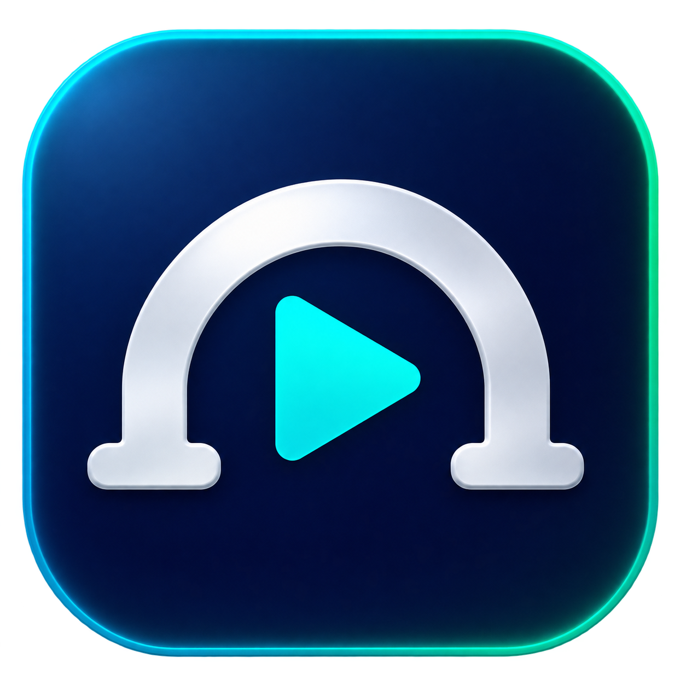

# MP10 Reason Bridge



A free, native macOS utility that translates the **Kawai MP10's MIDI Machine Control (MMC) transport messages** into **Mackie Control Universal (MCU) button messages** for Reason. A custom MIDI-note mode is also included.

The bridge creates its own virtual MIDI ports. Bome MIDI Translator, an IAC bus, and third-party libraries are not required.

**Status:** the project owner has confirmed that the CoreMIDI timestamp correction works with the Kawai MP10 and Reason 14 on macOS Tahoe. Version **1.5** retains the timestamp correction and automatic input reconnection, and adds menu-bar background operation. Universal builds, reconnect-selection tests and protocol/packet tests pass; the automated CoreMIDI/GUI integration test remains unavailable in the restricted development environment.

## Download and requirements

Download the app ZIP from [Releases](https://github.com/rommelfs/mp10-reason-bridge/releases/latest), extract it, and open **MP10 Reason Bridge.app**. Keep the app running while using the transport controls.

- macOS 13 or later; Apple Silicon or Intel Mac.
- Kawai MP10 connected over USB MIDI or a MIDI interface.
- Reason 14 is the intended host. Other MCU-capable hosts may work but have not been tested.
- No development tools are required to run the downloaded app.

The app is ad-hoc signed, **not Apple-notarized**. If macOS blocks it as an unidentified developer, review the app and use **System Settings → Privacy & Security → Open Anyway** if appropriate.

The app uses English throughout the interface, status messages, logs, and test output. Quit an older bridge before replacing it with the new app. Existing custom mappings and MIDI port names are preserved.

## Connect the MP10

1. Connect the MP10 to your Mac.
2. Start the bridge before opening Reason.
3. Choose the MP10's input in **MIDI Input** once. If using a MIDI interface, choose its corresponding port. The app remembers the choice and reconnects automatically on subsequent app launches or device reconnections. Click **Refresh** if needed.
4. Enable **TRANSPORT** on the MP10.
5. Press a transport button. The log should show an `IN` message with the decoded command and an `OUT` message with the generated note.

The MP10's button assignments are configurable under **MIDI EDIT → MMC**; see page 46 of the [MP10 manual](https://www.kawai.de/service/mp10.pdf). The incoming command may therefore differ from the button's printed label. Use the log to see what is actually transmitted.

## Run in the menu bar (v1.5)

The bridge is available from its bridge/play icon in the macOS menu bar.

- **Close or minimize the window:** hides it to the menu bar. MIDI translation and automatic reconnection continue running. The Dock icon is hidden while the window is hidden.
- **Show Window:** opens the existing window again with its current settings and restores the Dock icon.
- **Hide Window:** runs in the background without closing the MIDI connections.
- **Refresh MIDI Inputs:** refreshes the available input devices directly from the menu.
- **Quit MP10 Reason Bridge:** stops MIDI processing and exits the app.

The menu displays the connection status and current output mode. You can also use **⌘W** or **⌘M** while the bridge window is active to hide it. Reopening the running app from Finder shows its window again. Closing the window no longer quits the bridge; use **Quit** to exit.

The app starts with its window visible. Once your input has been selected, you can hide it and continue controlling Reason in the background. The monochrome menu-bar icon is a vector template so macOS can adapt it to light/dark menu bars; the full-color app icon is used in Finder and the Dock.

## Automatic reconnection (v1.4)

Select your MIDI input once after updating from v1.3. The app then remembers it and starts processing automatically when that input is available:

- **App restart:** reconnects to the remembered input and restores the existing output mode.
- **Device unplug/replug or power cycle:** waits for the remembered input and reconnects without pressing Refresh or reselecting it.
- **Device connected later:** displays **Waiting for …** until it appears. CoreMIDI notifications trigger a refresh; a two-second retry handles devices that become ready later.

The input is matched by its CoreMIDI unique ID. If the driver changes that ID, the app falls back to a single matching display name plus saved manufacturer/model information when available. If more than one input matches, select the intended input manually. The app does not switch to an unrelated MP10 while the remembered input is missing. Interfaces with indistinguishable names/metadata cannot always be identified individually by a driver that changes IDs.

Choosing **— Select input —** explicitly disconnects, forgets the input and disables automatic reconnection until another input is selected. On a fresh installation with no saved choice, a single input whose name contains MP10 is selected automatically. Generic names such as USB-MIDI may require the initial manual selection.

The virtual Reason input/output ports retain their CoreMIDI IDs from v1.4 onward. After the first upgrade from an older build, reselect the current ports in Reason once if needed. Quit other bridge instances if the app reports that a saved port ID is already in use.

The reconnect policy and persistence are covered by automated tests. Live unplug/replug and Reason reconnection still require target-Mac verification. **Monitor input only** is restored if it was the selected mode; select **Mackie Control (MCU)** for normal transport processing.

## Set up Reason 14 with Mackie Control

The following **Reason controller configuration is confirmed working**:

| Reason setting | Value |
| --- | --- |
| Manufacturer | `Mackie` |
| Model | `Control` |
| Input | `MP10 Reason Bridge` |
| Output | `MP10 Reason Bridge Feedback` |

These are the ports selected **inside Reason**. In the bridge app itself, select the physical MP10/interface input (for example `USB-MIDI`).

The default bridge **Output mode** is **Mackie Control (MCU)**. Later mode selections are remembered.

1. Open **Reason → Settings → MIDI**.
2. If an older bridge configuration exists, remove its generic controller entry. Keep your actual MP10 keyboard entry.
3. Choose **Add manually**, then **Manufacturer: Mackie**, **Model: Control**.
4. Set **Input: MP10 Reason Bridge** and **Output: MP10 Reason Bridge Feedback**, exactly as shown in the table above.
5. Keep the actual MP10 as your master keyboard for playing and recording notes.
6. Test Play, Stop, Record, Rewind, and Fast Forward.

This setup uses Reason's built-in Mackie mapping rather than individual Remote Overrides. **Add the surface manually:** automatic detection is not guaranteed. The bridge implements a transport subset and basic connection messages, not a complete Mackie mixing console.

Avoid multiple active Reason control-surface entries using the same bridge input. Clear old manual transport overrides when testing the native Mackie mapping; a Play override previously masked a connection problem. Each MMC Stop remains the same MCU Stop command; Reason handles stopping on the first press and returning to the song start on a second press.

## Updating from an earlier version

Quit the old bridge and Reason. Replace the app with v1.5, start the bridge, then reopen Reason. If Reason retained an unavailable port, re-select the Input and Output listed above. Custom note assignments are preserved.

Versions before the timestamp correction could emit correct MIDI bytes with invalid virtual-source timestamps. Version 1.3 supplies current Mach host time for every generated press, release and handshake packet, as required by [CoreMIDI's `MIDIReceived` contract](https://developer.apple.com/documentation/coremidi/midireceived(_:_:)). This corrected the reported Mackie problem in [issue #1](https://github.com/rommelfs/mp10-reason-bridge/issues/1).

## MCU mapping

All MCU button messages use **MIDI channel 1**:

| Input from MP10 | MCU button | Note number | Hex |
| --- | --- | ---: | --- |
| MMC Stop (`01`) | Stop | 93 | `5D` |
| MMC Play (`02`) | Play | 94 | `5E` |
| MMC Deferred Play (`03`) | Play | 94 | `5E` |
| MMC Fast Forward (`04`) | Fast Forward | 92 | `5C` |
| MMC Rewind (`05`) | Rewind | 91 | `5B` |
| MMC Record Strobe (`06`) | Record | 95 | `5F` |
| MIDI Realtime Start / Continue (`FA` / `FB`) | Play | 94 | `5E` |
| MIDI Realtime Stop (`FC`) | Stop | 93 | `5D` |

A press is **Note On, velocity 127**. After 80 ms, release is sent as **Note On, velocity 0**. For example:

```text
Play press:    90 5E 7F
Play release:  90 5E 00
```

The channel and notes are fixed in MCU mode. These values are protocol button IDs; they do not represent musical pitches here.

MMC Record Exit, Record Pause, Pause, Eject, Chase, Command Error Reset, and MMC Reset have no mapping in this mode. Their fields show `—`, their **Send** buttons are disabled, and incoming messages are logged and ignored. No unrelated MCU buttons are substituted for them.

### Host return path and handshake

`MP10 Reason Bridge Feedback` receives host messages separately from the MP10 input. For model ID `14` hex, the bridge handles Device Query, Host Connection Reply, Firmware Version Request, and Reset, using the virtual serial identifier `MP10BRG`. Connection replies appear in the log as `MCU handshake`.

LED, display, and fader feedback is ignored. It is never echoed as a button press, and it is not forwarded to the MP10.

## Custom MIDI-note mode

Choose **Custom MIDI notes** to assign any note number from 0–127 to each of the 16 recognized commands. The output channel is selectable from 1–16.

Existing custom assignments are preserved when switching to MCU mode and restored when switching back. Settings are stored locally using macOS user defaults. Press Enter, trigger a command, switch modes, or quit normally to save edited note values.

Custom-mode output uses Note On with velocity 100, followed after 80 ms by Note Off with velocity 0. This is a separate mode; its default assignments are **not an MCU mapping**. The legacy defaults include Play 94, Stop 95, and Deferred Play 96.

To use this mode in Reason:

1. Disable or remove the Mackie entry using the bridge port.
2. Add **Other → MIDI Control Keyboard**, using `MP10 Reason Bridge` as input and no MIDI output. Use a model with a keyboard so that notes are available as controls.
3. Right-click / Control-click a Reason transport control and choose **Edit Remote Override Mapping**.
4. Enable **Learn From Control Surface Input**, then press the MP10 button or the corresponding **Send** button in the bridge.
5. If learning does not select the note, manually choose the bridge surface, **Keyboard**, and the note number.
6. Save the Reason song. Remote Overrides are stored with the song; save a template if you want them in new songs.

Use different notes for commands that should be distinguishable. Octave labels differ between applications; use the numeric note ID rather than the displayed pitch name.

## Limitations and troubleshooting

- Each input event produces an 80 ms press. **Holding an MP10 button does not produce continuous held-button rewind or fast-forward.**
- Keyboard notes, CC messages, MIDI Clock, and unrelated SysEx are not passed through. Route your MP10 keyboard directly to Reason as before.
- MMC input accepts any device ID from 0–127. The bridge parses simple six-byte MMC commands `01`–`0D`, including messages fragmented across MIDI packets.
- The bridge does not reflect Reason's playback state or LEDs on the MP10.
- If no input appears, check the connection, select the correct input, and click **Refresh**.
- If transport events do not appear in the log, check **TRANSPORT** and the MP10's MMC assignments.
- If Reason cannot see a virtual port, start the bridge first and reopen Reason if needed. Check the bridge's status line for CoreMIDI errors.
- If notes sound instead of controlling transport, check that the bridge mode matches the Reason controller setup and that the actual MP10 remains the master keyboard.
- If an action fires twice, check for duplicate active surface entries using the bridge input.

## Build from source

Install Xcode or the Xcode Command Line Tools, then run:

```sh
git clone https://github.com/rommelfs/mp10-reason-bridge.git
cd mp10-reason-bridge
./build.command
```

The script compiles both `arm64` and `x86_64` for macOS 13+, combines them into a universal app, applies an ad-hoc signature, and runs the protocol self-tests. The app is written to `MP10 Reason Bridge.app` in the repository directory. It has no package dependencies. The checked-in artwork is packaged into a ten-representation ICNS app icon and an 18-point vector menu template by `Tools/IconBuilder.swift`, using Apple frameworks. Building does not require image-generation tools or API keys.

## Diagnostics

The optional **Raw MIDI log**, **Copy Log**, **Clear Log**, and **Monitor input only** controls help compare hardware and bridge messages. See [DIAGNOSTICS.txt](DIAGNOSTICS.txt). Normal use requires **Mackie Control (MCU)** mode; monitor-only mode sends no transport commands.

## Tests

Run the protocol self-tests without opening a GUI or starting CoreMIDI:

```sh
"MP10 Reason Bridge.app/Contents/MacOS/MP10ReasonBridge" --self-test
```

These cover saved-input serialization, stable-ID matching, changed-ID fallback, missing/ambiguous devices, explicit disconnection, and the production packet builder (valid nonzero host timestamps, captured UFX payloads, buffer limits and delivery errors), MMC parsing and fragmentation, realtime messages, invalid input, MCU mappings and exact press/release bytes, custom notes and channels, unmapped commands, and handshake success/error cases.

On a Mac with a graphical session and CoreMIDI available, run:

```sh
"MP10 Reason Bridge.app/Contents/MacOS/MP10ReasonBridge" --integration-test
```

This briefly opens a test window and creates a virtual MP10 and test receiver. It checks packet traversal, both output modes, preservation of custom assignments, feedback without echo, the handshake, source unplug/replug followed by resumed translation, explicit disconnect, virtual-port identity restoration, and MIDI delivery with the window hidden. It uses a separate temporary preferences domain. It does not replace testing with a physical MP10 and Reason.

## Source files

- `Bridge.swift`: app, stream parsers, translation rules, host handshake, and tests.
- `Info.plist`: app metadata and minimum macOS version.
- `build.command`: universal build, icon packaging, signing, and protocol self-test script.
- `Tools/IconBuilder.swift`: reproducible ICNS packaging and menu-bar template drawing.
- `Assets/AppIcon.png`: original generated app-icon artwork.
- [Icon provenance and final generation prompt](Assets/AppIcon-prompt.txt).

## References

- [Kawai MP10 manual](https://www.kawai.de/service/mp10.pdf), MIDI section and MMC assignments, pages 31 and 46.
- [Reason 14 Remote documentation](https://docs.reasonstudios.com/reason14/remote-playing-and-controlling-devices).
- [Mackie/Emagic Logic Control manual](https://htlab.net/computer/protocol/mackie-control/LogicControl_EN.pdf), MIDI implementation: switches and host connection.
- [MCU protocol research based on original hardware](https://github.com/NicoG60/TouchMCU/blob/main/doc/mackie_control_protocol.md), model IDs and MCU extensions.

## License

[MIT](LICENSE.txt). This is an independent project and is not affiliated with Kawai, Reason Studios, or Mackie.
